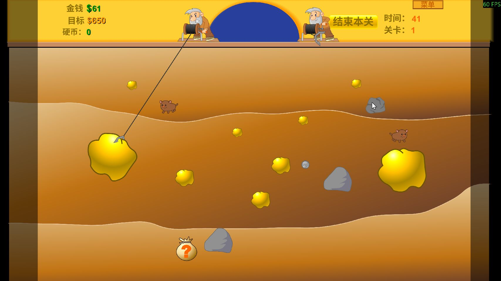

# Gold Miner Single-Player Campaign Co-op

Play the original **Gold Miner: Classic Edition** single-player levels with two local players. This unofficial mod adds a second independently controlled miner to the existing single-player campaign.

[Download the latest release](https://github.com/yuGAN6/gold-miner-solo-coop/releases/latest) · [中文说明](README.zh-CN.md) · [Development guide](docs/DEVELOPMENT.md)



## Features

- Independent miners, claws and collection animations.
- Arrow keys for the left player; WASD for the right player.
- Shared money, objectives, inventory and countdown.
- Existing single-player level layouts and progression.
- A portable installer with exact-build checks, original-file backup and uninstall support.

The original separate two-player mode is unchanged. This mod is for playing the **single-player levels together**.

## Requirements

| Item | Supported version |
| --- | --- |
| Platform | Windows Steam edition |
| Steam App ID | `3777060` |
| Game version | `2.0.0` |
| Steam build | `26673644` |
| Installer runtime | Windows PowerShell 5.1 and .NET, included with Windows |

Compatibility is checked against the original `resources/app.asar` SHA-256, not just the displayed version number:

```text
751653bc50d01951a450a3cc24a1a7b7682e96033a38218c5adc9cb5f2225727
```

The installer refuses a different build or another modified archive. Python, Java, Node.js and FFDec are **not needed to install a release**.

## Install

1. Download `GoldMiner-Solo-Coop-v0.1.0.zip` from [Releases](https://github.com/yuGAN6/gold-miner-solo-coop/releases).
2. Extract the entire ZIP and close the game.
3. Double-click `Install.cmd`. It looks for the Steam installation and asks for the folder containing `GoldMiner.exe` if needed. You can also drag that game folder onto `Install.cmd`.
4. Launch the game normally from Steam and select **Single Player**.

Download the release ZIP rather than GitHub's automatically generated **Source code** ZIP: the source archive does not contain the patch payload.

## Controls

| Action | Left player | Right player |
| --- | --- | --- |
| Drop claw | Down | S |
| Use dynamite while retrieving, when available | Up | W |
| Original Left action | Left | A |
| Original Right action | Right | D |

Miners retain the original automatic swing. In classic gameplay, A uses a freeze box when available and D usually has no action. Modes with manual retraction retain their original Left/Right mechanics through A/D.

## Uninstall and updates

Close the game and run `Uninstall.cmd` against the same installation. Keep `resources/app.asar.goldminer-coop-original`; it is the verified original backup.

Steam updates or **Verify integrity of game files** may remove the mod. Reinstall only when the original archive still matches the supported build. The installer and uninstaller will not overwrite an unknown updated/modded archive with this older version. Use Steam's file verification to restore the current official build when needed.

## How the patch works

The release contains a copy/literal delta for `app.asar`. The installer copies unchanged bytes from the recipient's original installation and inserts the changed data, verifies the complete result, backs up the original and atomically replaces the archive.

The mod duplicates the miner, claw, button and collection-animation symbols in each of the four single-player SWF variants. Player 2 has independent instances and WASD button events. Collision checks prevent claiming an already collected object; countdown settlement checks both collection animations. The four modified `rf.swf` hashes and the ASAR integrity metadata are updated.

Unchanged launcher code, including embedded key material, is reused from the original installation rather than included as literal launcher code in the release delta. The package is not a standalone copy of the game.

## Validation and limitations

- The author has play-tested the mod in the actual game, including independent control and shared scoring.
- The installer was tested on isolated archive copies for clean install, repeated install, uninstall, mismatched versions, damaged payloads, failed output validation, folder discovery and missing backups.
- The generated game archive matches the tested modded archive byte for byte.
- A full campaign playthrough, every special item/late-game obstacle combination and a second physical computer have not been validated.
- Original save, achievement and leaderboard integration remains in place; there is no separate mod record system.
- Other mods that change `app.asar` are not automatically merged.

This is an unofficial project, not affiliated with or endorsed by the original game's developers or publisher. Original game code and assets remain the property of their respective owners.

## Development

See [docs/DEVELOPMENT.md](docs/DEVELOPMENT.md) for preparing build inputs from a compatible game installation, building the SWFs and exporting/testing the installer. Decompiled game files, full archives and third-party tool binaries are excluded from this repository.
