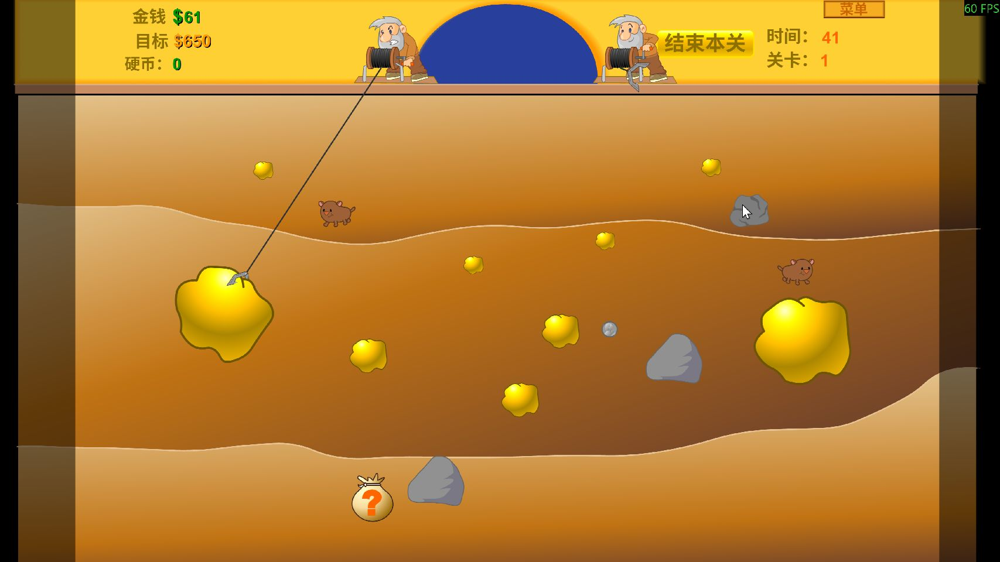

# 黄金矿工单人关卡本地双人 Mod

在《**黄金矿工：经典版**》原有的单人关卡中进行本地双人合作。这个非官方 Flash Mod 为现有单人流程加入第二名可独立操作的矿工。

[下载最新版本](https://github.com/yuGAN6/gold-miner-solo-coop/releases/latest) · [English README](README.md) · [开发指南](docs/DEVELOPMENT.md)

## 功能

- 独立的矿工、抓钩和收获动画。
- 左侧玩家使用方向键，右侧玩家使用 WASD。
- 共享金钱、目标、道具库存和倒计时。
- 保留原有单人关卡的布局和流程。
- 支持松散 Flash 文件安装，或在 Electron ASAR 中按资源名称添加覆盖加载。

原有的独立双人模式保持不变。本 Mod 用于**两人共同游玩单人关卡**。

## 运行要求

| 项目 | 要求 |
| --- | --- |
| 安装器平台 | Windows，自带 Windows PowerShell 5.1 和 .NET |
| 松散 Flash 安装 | 包含 `rf.swf` 的文件夹；存在对应语言版本时一并替换 |
| 封装版安装 | 包含预期启动脚本和 SWF 包读取接口的 `app.asar` 或 `resources/app.asar` |
| Steam 标识 | 不检查 App ID、build 编号或显示的版本号 |
| 原文件哈希 | 没有整个游戏包或原 SWF 的哈希白名单 |

**安装发行版无需 Python、Java、Node.js 或 FFDec**。封装版覆盖逻辑运行于游戏现有的 Electron 环境中。

安装器仍检查资源结构和 Mod 文件完整性。取消版本限制不代表能适配无关的 Flash 游戏或不兼容的启动器结构。被替换的 `rf.swf` 内已有的修改不会合并到提供的双人 SWF 中。

## 安装

1. 从 [Releases](https://github.com/yuGAN6/gold-miner-solo-coop/releases) 下载 `GoldMiner-Solo-Coop-v0.1.1.zip`。
2. 完整解压 ZIP，并关闭游戏。
3. 双击 `Install.cmd`，选择包含 `rf.swf`、`app.asar` 或 `resources/app.asar` 的文件夹。也可以把该文件夹拖到 `Install.cmd` 上；安装包放在游戏目录内或其下一级时可自动识别。
4. 照常启动游戏，选择“**单人游戏**”。Steam 安装仍可通过 Steam 启动。

请下载发行版 ZIP。GitHub 自动生成的“**Source code**”ZIP 不包含 Flash 补丁文件。Mod 文件哈希和写入结果检查仍保留，用于发现下载损坏或写入错误。

## 操作

| 动作 | 左侧玩家 | 右侧玩家 |
| --- | --- | --- |
| 出钩 | ↓ | S |
| 回收时使用炸药（需要库存） | ↑ | W |
| 原左方向键动作 | ← | A |
| 原右方向键动作 | → | D |

矿工保留原作的自动摆钩机制。经典玩法中，A 在有库存时使用冰冻箱，D 通常没有动作。需要手动回收的模式通过 A/D 保留原有的左右方向键机制。

## 卸载与更新

关闭游戏，对同一文件夹运行 `Uninstall.cmd`。

封装版卸载会从**当前** ASAR 中移除本 Mod 的启动脚本及哈希覆盖钩子，保留安装前后对其他内容的修改。原有 `swf.pack` 始终不改写。完整的安装前 ASAR 快照保存在游戏包旁，文件名为 `app.asar.goldminer-coop-*.bak`；覆盖资源和安装状态保留在 `goldminer-solo-coop/` 中，供再次使用。

松散 Flash 安装会恢复安装前备份的 SWF。请保留 `.goldminer-coop-backups/` 和 `.goldminer-solo-coop-state.json`。恢复会替换目标 SWF，包括安装后对这些文件所作的修改。

游戏更新可能移除覆盖钩子或替换 Flash 文件。只要资源结构仍受支持，就可重新安装，不再限制 Steam build 或整包哈希。从 v0.1.0 迁移时，如果希望新版卸载后恢复官方文件，请先卸载旧版，否则可能保留旧版 Mod。

## 补丁原理

发行包包含四份已编译的双人 `rf.swf` 和按资源结构工作的安装器，不再使用固定偏移的整包 ASAR 二进制差分。

松散文件模式会备份并替换已有目标 SWF。封装版模式按条目名称重建**当前** ASAR，为 `main/swf-pack.js` 添加有标记的覆盖加载逻辑，并为当前 `SWF_SHA_BAKED` 表达式附加四个替换哈希。其他文件条目及启动器修改会保留。游戏自身的 Flash 完整性校验仍然启用，使用更新后的哈希；修改条目的 ASAR 元数据也会重新计算。

Flash Mod 会复制矿工、抓钩、按钮及收获动画符号。第二名玩家拥有独立实例和 WASD 事件，碰撞与倒计时结算同时考虑两名玩家。原有嵌入密钥留在接收者自己的游戏中，不包含在发行包内。

## 验证与限制

- Flash 玩法已在实际游戏中测试，包括独立操作和共享计分。
- v0.1.1 安装器已在没有 Steam 文件或 EXE 的修改版 ASAR 副本，以及独立／修改过的 `rf.swf` 文件上测试。
- 测试涵盖重复安装、快照备份、保留其他修改、卸载、拒绝损坏补丁和处理无效游戏包。
- 已使用实际游戏的 SWF 包读取器测试覆盖逻辑：四份 Mod Flash 及其哈希均匹配，原生双人 SWF 保持不变。
- 尚未验证完整通关、所有特殊道具和后期机关组合或另一台实体电脑；新覆盖安装器已通过隔离与运行时测试，尚未重新进行完整桌面游戏实测。
- 保留原游戏的存档、成就和排行榜集成，没有独立的 Mod 记录系统。
- 松散 SWF 替换不会合并其他 Flash 修改。封装版会保留其他游戏包条目，但要求预期的启动器和 SWF 包读取接口。

本项目为非官方项目，与原游戏开发商或发行商无隶属关系，也未获得其背书。原游戏代码和素材归各自的权利人所有。

## 开发

参见 [docs/DEVELOPMENT.md](docs/DEVELOPMENT.md)，了解如何准备本地输入、编译 SWF，以及导出和测试安装器。本仓库不包含反编译后的游戏文件、完整游戏包或第三方工具二进制文件。
